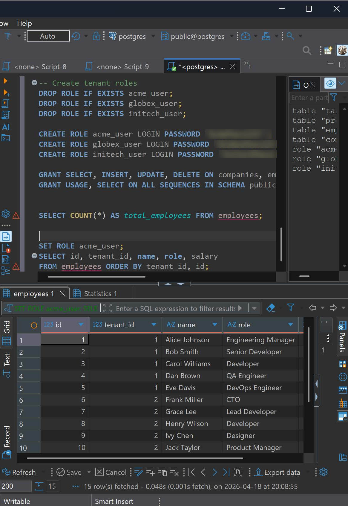
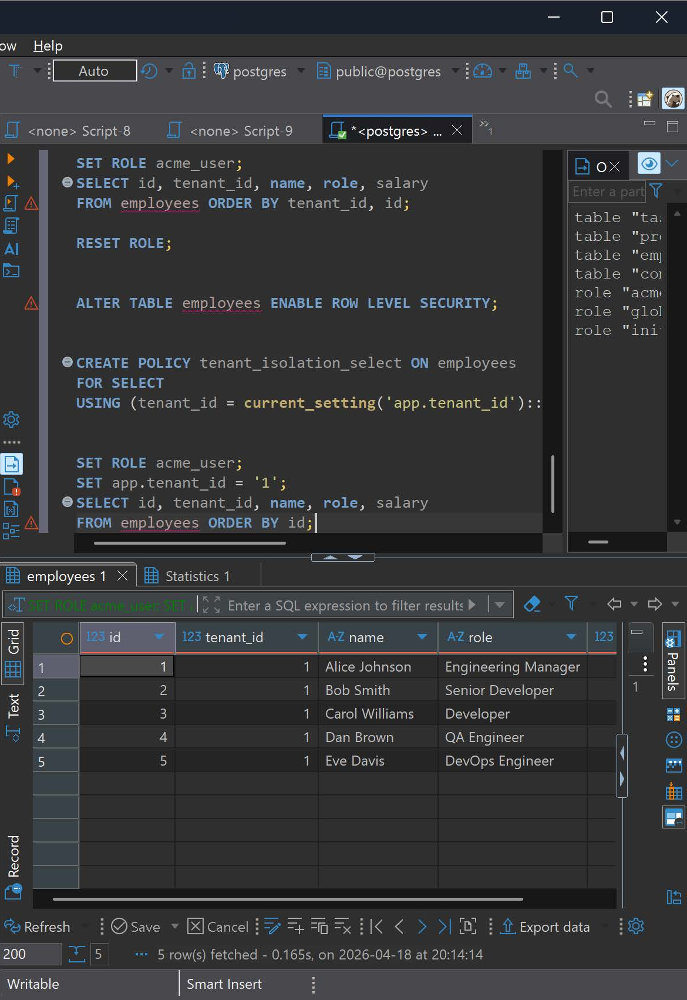
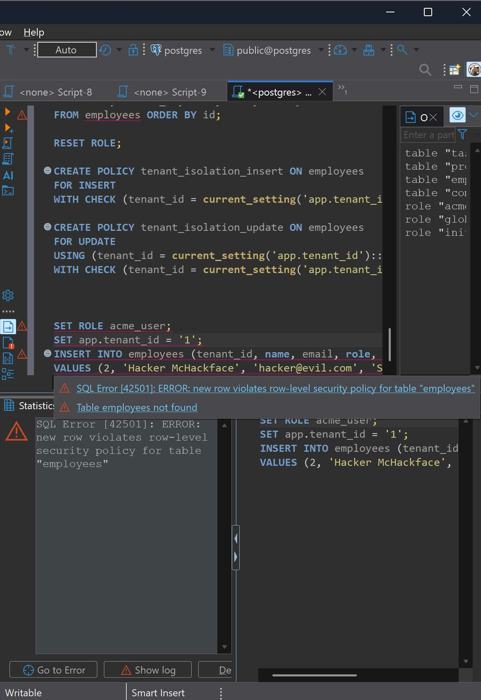
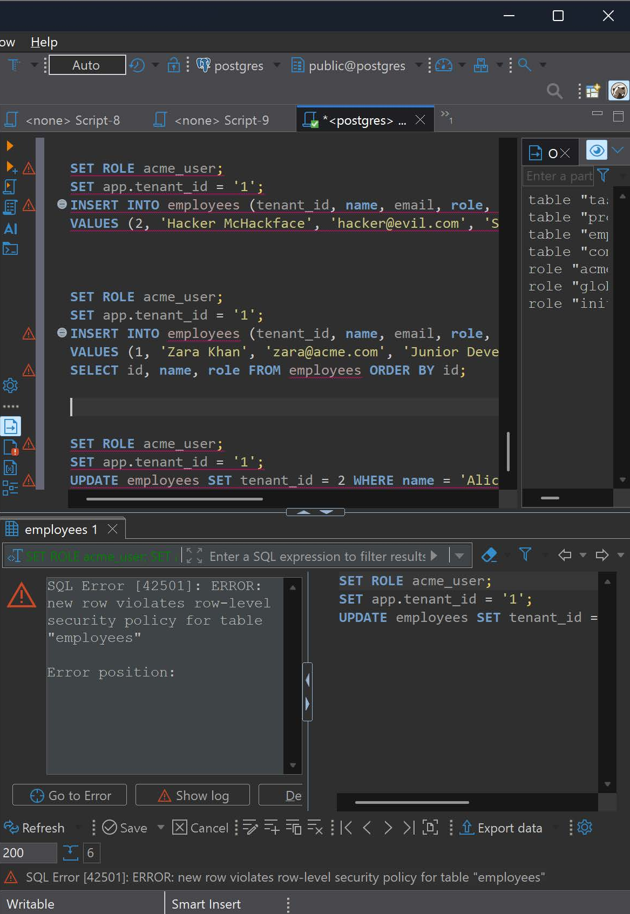
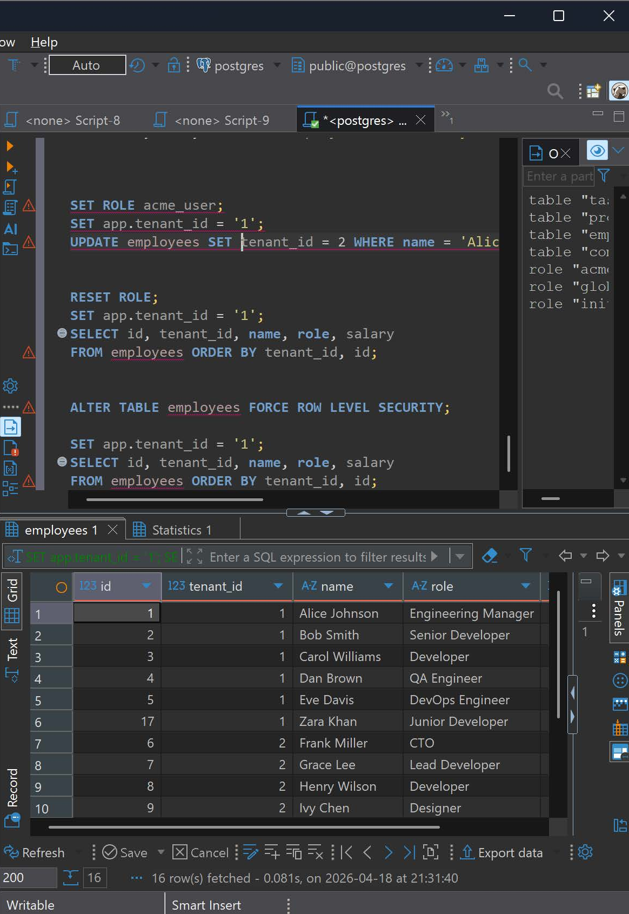
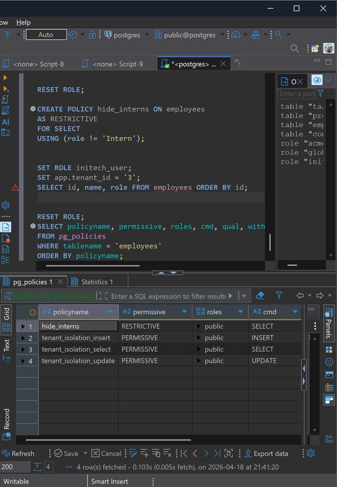
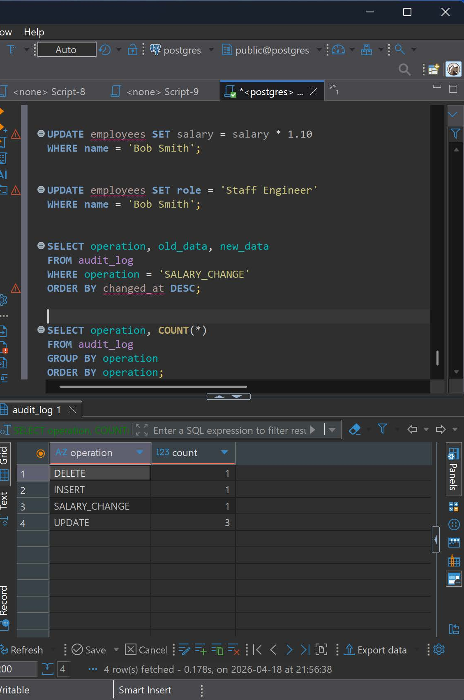
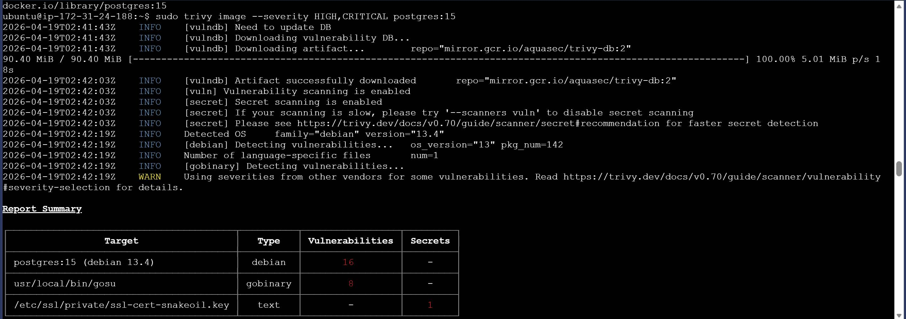

# Multi-Tenant Database Security on AWS

A SaaS app keeps three client companies' data in the same PostgreSQL tables. I made sure each company can only see and change its own rows, closed a cloud-specific bypass, added audit logging, and scanned the database container for known vulnerabilities.

**Environment:** PostgreSQL on AWS RDS · DBeaver · AWS EC2 (Ubuntu) · Trivy
**Built as part of:** DBAS 17370 Database Security, Sheridan College (Winter 2026)

## The problem

Table permissions (`GRANT`) control which **tables** a user can read, not which **rows**. Before row-level security, Acme's database user could see all 15 employees from all three companies, including names, emails and salaries.



## 1. Row-level security (RLS)

The app tells PostgreSQL which company the session belongs to (`app.tenant_id`), and a policy filters every query to that company's rows automatically.

```sql
-- Turn on row-level security for the table
ALTER TABLE employees ENABLE ROW LEVEL SECURITY;
-- Reads: only rows where tenant_id matches the session's tenant
CREATE POLICY tenant_isolation_select ON employees
  FOR SELECT
  USING (tenant_id = current_setting('app.tenant_id')::INT);
```

Acme now sees only its 5 employees:



## 2. Blocking writes into another company

- **USING** controls which existing rows you can touch.
- **WITH CHECK** controls what a row is allowed to become.

An `UPDATE` needs both. Otherwise a user could edit their own row and move it into another company.

```sql
-- Inserts must belong to the session's tenant
CREATE POLICY tenant_isolation_insert ON employees
  FOR INSERT
  WITH CHECK (tenant_id = current_setting('app.tenant_id')::INT);
-- Updates: can only target own rows, and the result must still be own tenant
CREATE POLICY tenant_isolation_update ON employees
  FOR UPDATE
  USING (tenant_id = current_setting('app.tenant_id')::INT)
  WITH CHECK (tenant_id = current_setting('app.tenant_id')::INT);
```

| Attack | Result |
|---|---|
| Insert a fake employee into Globex while logged in as Acme |  |
| Move Alice's row from Acme to Globex with `UPDATE ... SET tenant_id = 2` |  |

Both fail with `new row violates row-level security policy`.

## 3. The cloud gap: table owners bypass RLS

By default, **the table owner ignores every RLS policy**. On AWS RDS, apps often connect as the owner, which would silently disable all of the above.

```sql
-- Make the policies apply to the table owner too
ALTER TABLE employees FORCE ROW LEVEL SECURITY;
```



I also tested **restrictive** policies, which must *all* pass (AND), unlike the default permissive policies, where *any* can pass (OR).



## 4. Audit logging with triggers

A trigger writes every insert, update and delete to an `audit_log` table: who made the change, when, and the old and new values. A second, fine-grained trigger records only salary changes, so sensitive edits stand out.



## 5. Vulnerability scan with Trivy

From an EC2 instance, I scanned the official PostgreSQL 15 Docker image for known CVEs:

```bash
# Show only HIGH and CRITICAL vulnerabilities in the image
sudo trivy image --severity HIGH,CRITICAL postgres:15
```

It found 16 OS-package and 8 Go-binary vulnerabilities, plus a private key bundled in the image (a default self-signed "snakeoil" key).



## Problems I hit

- **Couldn't log in to RDS:** reset the master password in the AWS console. DBeaver still failed because two saved connections were caching the old password. I deleted both and made one fresh connection.
- **Couldn't SSH into the scanner:** the security group only allowed my old IP. I opened SSH to `0.0.0.0/0` to finish, which exposes port 22 to every bot scanning AWS. **What I'd do now:** restrict it to "My IP" or use AWS Systems Manager so no SSH port is open at all.

## What I learned

- **Test as the real application account.** Admin testing hides problems like the owner bypass.
- **Isolation needs both read and write rules.** USING alone still allows moving data between tenants.
- **Audit logs answer "who changed this?"** That's essential for incident response and compliance.
- **Trusted images still carry CVEs.** Scan them before deploying and keep them updated.
-e 
More detail on these problems is in my [IT Troubleshooting Log](https://github.com/ikassem-cyber/it-troubleshooting-log/blob/main/cases/05-aws-database-security.md).
